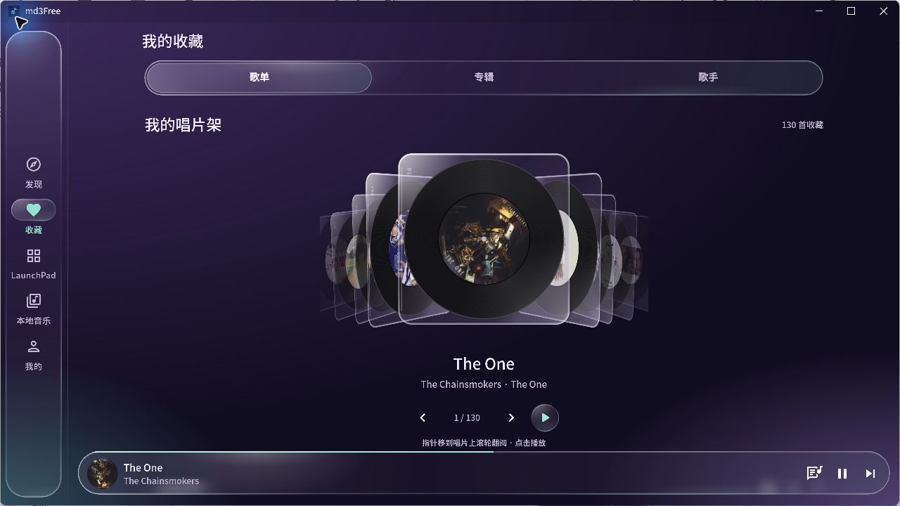
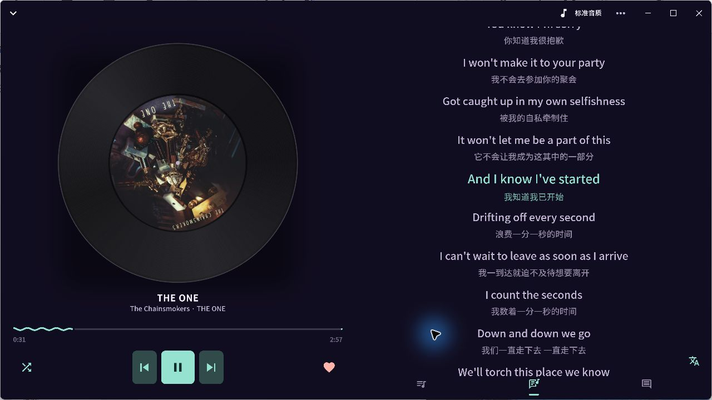
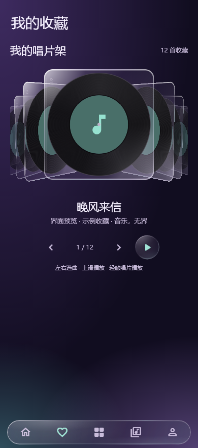

# md3Free

  

**基于 [MD3Music](https://github.com/zzyoxml/md3Music) 的个人 UI 美化版，支持 Windows 与 Android。**

想把常用的音乐播放器，改成更合自己眼缘的样子。md3Free 在 MD3Music 6.3.0 的基础上，参考 TuneFree 的视觉风格，加入紫色氛围、半透明玻璃组件和可翻阅的唱片架，让听歌多一点仪式感。

搜索、播放、收藏和歌词等基础能力来自 MD3Music；本分支主要调整界面、动效与交互细节。它是个人维护的非官方衍生版本，感谢原作者与所有贡献者。

[下载双端最终版](https://github.com/BrokenHT/md3Free/releases/latest) · [更新说明](CHANGELOG.md) · [构建说明](MD3FREE_BUILD.txt) · [原项目说明](README.upstream.md)

## 下载与使用

当前发行版本为 **6.3.0-r3**，应用内部版本号沿用 **6.3.0**。

| 平台 | 下载文件 | 使用方法 |
| --- | --- | --- |
| Windows x64 | [Windows 便携版](https://github.com/BrokenHT/md3Free/releases/download/v6.3.0-r3/md3Free-6.3.0-Windows-x64.zip) | 完整解压后运行 `md3Free.exe`，保留旁边的 DLL 和 `data` 目录。 |
| Android arm64 | [Android APK](https://github.com/BrokenHT/md3Free/releases/download/v6.3.0-r3/md3Free-6.3.0-standard-arm64-v8a.apk) | 适用于 arm64 设备；使用独立包名，可与原版 MD3Music 并存。 |

Android 包名为 `com.brokenht.md3music.tunefree`，本次发行沿用 r3 的签名，可覆盖此前同签名的 md3Free。Android 版为标准功能版，不包含全功能包额外的本地 AI 模型。

发行页同时提供对应源码和 `SHA256.txt`。本版应用内更新入口仍保留原 fork 地址，请通过本仓库的 Releases 下载 md3Free。

## 特色功能

- **统一的玻璃界面**：紫色渐变氛围、轻薄玻璃边缘、半透明搜索栏、导航和播放栏。
- **可以翻阅的唱片架**：收藏歌曲变成黑胶唱片；桌面滚轮翻阅，手机滑动选曲，支持首尾循环。
- **播放中的唱片会旋转**：唱片架、播放栏、播放详情和歌词胶囊的专辑图随播放旋转，暂停保留角度；唱片架的玻璃套与编号保持静止。
- **紧凑的歌词胶囊**：封面、歌名与歌词集中显示，长歌词平滑往返滚动；Windows 使用系统合成背景，Android 使用透明悬浮样式。
- **更顺手的日常细节**：搜索与侧栏同步过渡、手机纯图标导航、每日首次进入自动签到；签到失败可重试，验证码仍需本人处理。

## 界面截图

以下 Windows 图片均截取自本次发布的 r3 正式运行版本。

### 首页与玻璃播放栏

### 收藏唱片架

支持滚轮翻阅、点击播放；正在播放歌曲的专辑标签会旋转。

### 黑胶播放页与歌词

### 桌面歌词胶囊

### 手机布局预览

下图由同版本 Flutter 组件以 390 px 宽度渲染，使用示例收藏数据，属于界面预览。Android 包已完成 release 构建与签名，尚未完成真机实测；实际手机的帧率与系统悬浮窗效果需以设备表现为准。

## 来源与许可

- 原项目：[zzyoxml/md3Music](https://github.com/zzyoxml/md3Music)。本次修改基于 [BrokenHT/md3Music](https://github.com/BrokenHT/md3Music) 的 `0d99847` 提交。
- 本仓库保留原项目 **AGPL-3.0** 许可及第三方声明，见 [LICENSE](LICENSE)、[第三方组件许可](third_party) 与 [字体声明](windows/runner/fonts/NOTICE.txt)；原项目免责声明见 [DISCLAIMER.md](DISCLAIMER.md)。
- TuneFree 提供视觉与交互方向参考；MD3Music 的底层能力及原贡献者署名均予以保留。
- 音乐、歌词、专辑封面及相关商标归各自权利人所有。截图仅用于展示界面，发行包不附带音乐文件。

本仓库发布已完成的双端 r3 构建。上游工作流保存在 [docs/upstream-workflows](docs/upstream-workflows) 供参考，未启用自动构建或自动发布；自行构建请参考 [MD3FREE_BUILD.txt](MD3FREE_BUILD.txt)，Android 私钥与签名密码不随源码提供。
